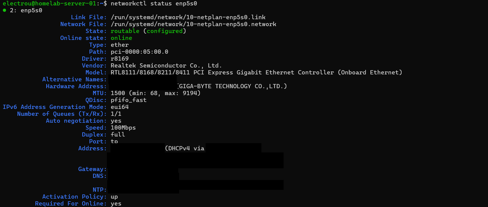
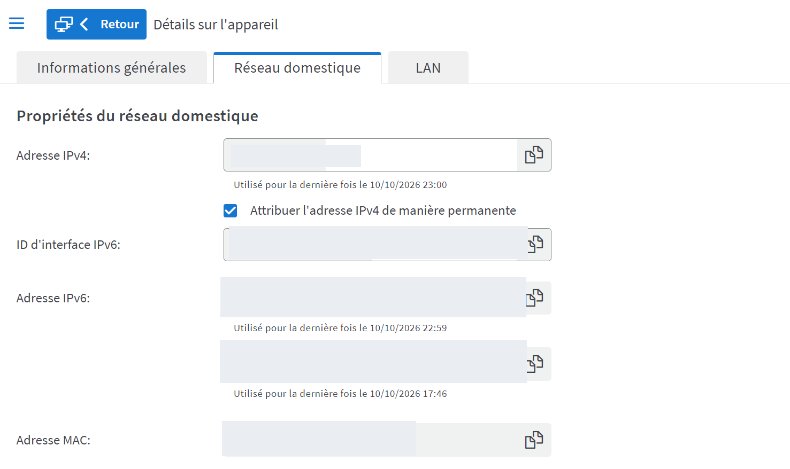
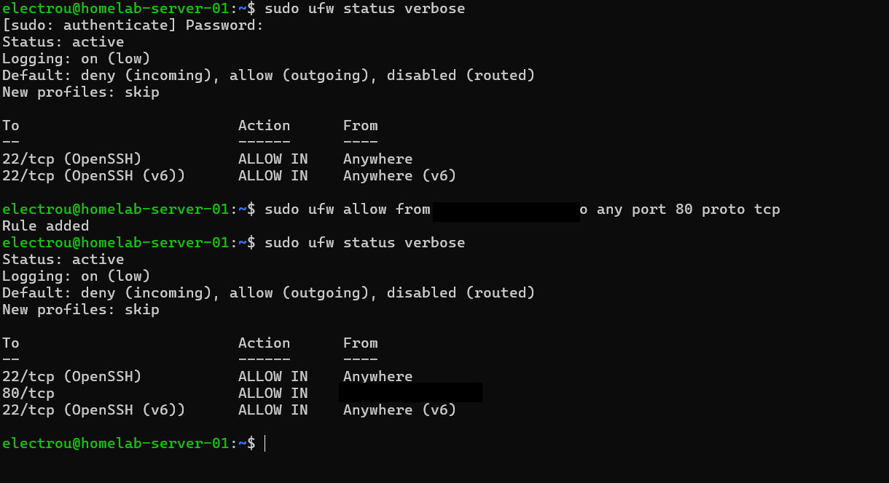
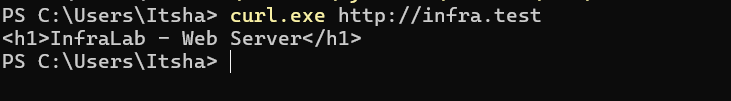
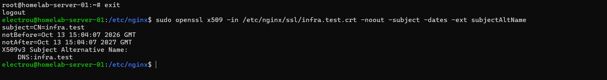
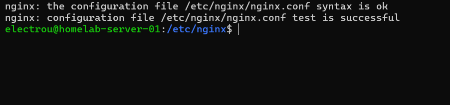
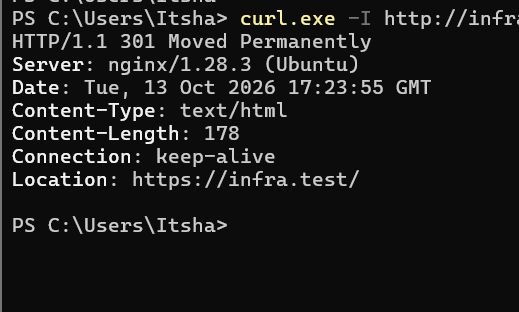
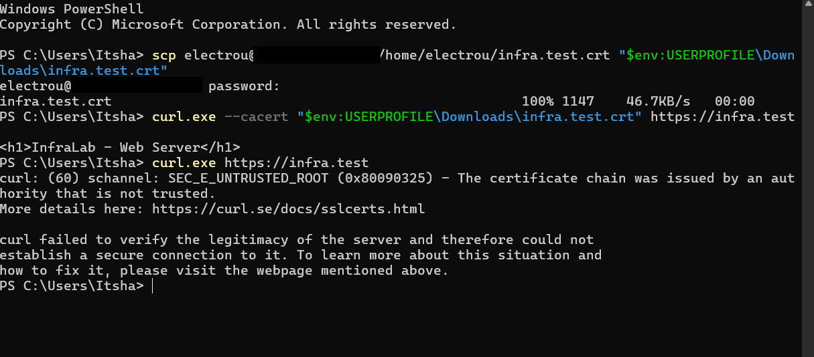

# InfraLab — Infrastructure

*A physical Ubuntu Server, a Windows workstation, and a home LAN.*  
*Technical reference · Last documented: 15 October 2026*

This page describes **what I have actually set up and verified** in my home lab. I update it when the infrastructure changes—not every time I practise a command or solve an exercise.

For the mistakes, troubleshooting challenges, and weekly progress, see my [learning log](./LEARNING_LOG.md). The original terminal and router screenshots are kept in [`evidence/`](./evidence/); identifying network details have been masked.

## The setup

```text
 Windows PC                               FRITZ!Box
 PowerShell, curl.exe, SSH, SCP            LAN router / DHCP
     |                                         |
     +---------------- Ethernet LAN ----------+
                                               |
                                         Ubuntu Server
                                         enp5s0 — DHCPv4
                                         SSH :22
                                         UFW firewall
                                         Nginx :80  → HTTP 301 → HTTPS
                                         Nginx :443 → TLS → index.html
```

| Part | What is implemented |
| --- | --- |
| Server | A physical Ubuntu Server on the local Ethernet network |
| Client | Windows workstation used for administration and external tests |
| Router | FRITZ!Box providing the gateway, DHCP and local DNS configuration |
| Remote access | SSH from Windows; SCP used to transfer a public TLS certificate |
| Web server | Nginx with a named virtual host for `infra.test` |
| Website | Static file at `/var/www/infralab/index.html` |
| Network policy | UFW active; web ports restricted to the Windows test client |
| HTTPS | Self-signed TLS certificate, with certificate-based verification in curl |

This is a **local learning environment**, not a production system or an Internet-exposed service. IP addresses shown as `<SERVER_IP>` or `<WINDOWS_IP>` are documentation placeholders, not actual values to paste into commands.

## 1. LAN addressing and DHCP reservation

I identified the Linux network interface with `ip -br addr` and checked its configuration with `networkctl status enp5s0`. On Windows I used `ipconfig` to find the Ethernet interface actually connected to the same LAN.

Ubuntu receives its IPv4 address from the FRITZ!Box **using DHCPv4**. To make the address more consistent for my client-specific firewall rules, I enabled **« Attribuer l'adresse IPv4 de manière permanente »** for the Ubuntu machine on the router. I saved the setting and confirmed that it remained selected when I reopened the device settings.

This is a **DHCP reservation on the router**, not a manually configured static IP on Ubuntu. I have **not yet tested a lease renewal or reboot** to confirm that the reserved address is reassigned afterward.





## 2. Network access, firewalls and SSH

My first connectivity tests showed that Windows could ping Ubuntu, but Ubuntu initially could not ping Windows. The cause was an inbound Windows Firewall rule for **ICMPv4 Echo Request**. I corrected its scope so Ubuntu was treated as the *remote/source* IP, not the Windows local IP. After that, Ubuntu received **4 of 4** ping replies.

A successful ping did **not** mean other services were accessible. When Nginx first responded locally but not from Windows, I found that **UFW denied inbound TCP 80** from the client. I added a rule scoped to the Windows test computer; the same approach was later used for **TCP 443**.

The earlier OpenSSH rules still allowed broader access than my web rules, including IPv6. I **have not completed SSH firewall hardening**. There is no claim that this setup is production-hardened.

I also connected from Windows to Ubuntu via SSH. Inspecting `ssh.service` and `ssh.socket` showed how a systemd socket can listen on TCP 22 and activate the SSH service when needed. A service being active, enabled, and listening are different questions.



## 3. Nginx and local name resolution

The Nginx default site remains enabled. I added a separate site definition:

- Configuration: `/etc/nginx/sites-available/infralab`
- Enabled link: `/etc/nginx/sites-enabled/infralab`
- Web root: `/var/www/infralab`
- Website name: `infra.test`

Sending `Host: infra.test` to the server returned **`<h1>InfraLab - Web Server</h1>`**, while an IP-only HTTP request could return the default **Welcome to nginx!** site. That distinction taught me how name-based virtual hosts are selected.

I mapped `infra.test` to the server's LAN address in the **Windows `hosts` file**. This is **client-side name resolution**, not a network-wide DNS server. I initially edited a copy without successfully saving the protected Windows file, then corrected it by editing the actual file as administrator.



The current Nginx configuration belongs in [`nginx/infralab.conf`](../nginx/infralab.conf). That version should be kept in sync with the real Ubuntu file whenever the service configuration changes.

## 4. HTTPS and file permissions

I generated an RSA private key and a self-signed certificate for **`infra.test`**, including `DNS:infra.test` in the **Subject Alternative Name (SAN)**. The certificate was created with OpenSSL and was valid from **13 October 2026 to 13 October 2027**.

The TLS files are stored locally under `/etc/nginx/ssl/`:

| Path | Intended permissions | Reason |
| --- | --- | --- |
| `/etc/nginx/ssl/` | `700`, root-owned | Only root can enter the directory |
| `infra.test.key` | `600`, root-owned | Private key must not be publicly readable |
| `infra.test.crt` | Public certificate | Contains the certificate, not the secret private key |

**The private `.key` file is not stored in GitHub.** The certificate is self-signed; Windows does not trust it automatically.



Nginx now has two separate responsibilities:

```nginx
# Port 80 — redirect clients to HTTPS
return 301 https://$host$request_uri;

# Port 443 — handle TLS and serve the static site
listen 443 ssl;
ssl_certificate /etc/nginx/ssl/infra.test.crt;
ssl_certificate_key /etc/nginx/ssl/infra.test.key;
```

These are excerpts, **not a complete standalone Nginx configuration**. Before applying changes, I use `sudo nginx -t`, followed by a controlled `systemctl reload nginx` only when the test succeeds.



## 5. Verification from Windows

I checked service availability in several ways rather than treating `nginx active` as proof that the website works.

| Check | Observed result |
| --- | --- |
| `ss -lntp` on Ubuntu | Nginx listened on TCP 80 and 443 |
| `curl.exe -I http://infra.test` | HTTP **301**, `Location: https://infra.test/` |
| `curl.exe https://infra.test` | `SEC_E_UNTRUSTED_ROOT` — Windows did not trust the self-signed issuer |
| `curl.exe -k https://infra.test` | Website responded with certificate verification **disabled**; diagnosis only |
| `curl.exe --cacert ... https://infra.test` | Website returned the expected HTML using the supplied public certificate |
| `curl.exe -L --cacert ... http://infra.test` | Redirect followed to HTTPS and returned the webpage |

I transferred the **public `.crt` only** from Ubuntu to Windows using SCP. The verified end-to-end request was:

```powershell
curl.exe -L --cacert "$env:USERPROFILE\Downloads\infra.test.crt" http://infra.test
```

The successful test does **not** mean that the certificate was installed as trusted system-wide in Windows. It was supplied explicitly to curl for that request. The initial HTTP request before the redirect is also not encrypted; HSTS has not been configured.





## What is still unfinished

- Verify the DHCP reservation across a lease renewal or server restart.
- Review and narrow SSH firewall exposure.
- Decide on a more appropriate certificate trust approach for local browser use and manage renewal.
- Build repeatable health checks, inspect logs and automate basic diagnostics.
- The website is a **static HTML page**. I have not built an application backend, cloud deployment or production monitoring here.

The deliberate troubleshooting exercises are described in [Week 1 — Learning Log](./Learning/Week1.md), not here. The Bash failure scripts were **generated with AI at my request**, rather than written by me, and this documentation was edited with AI assistance. The configuration, tests and screenshots refer to activity on my own lab machines.
