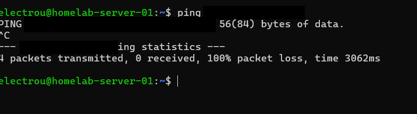
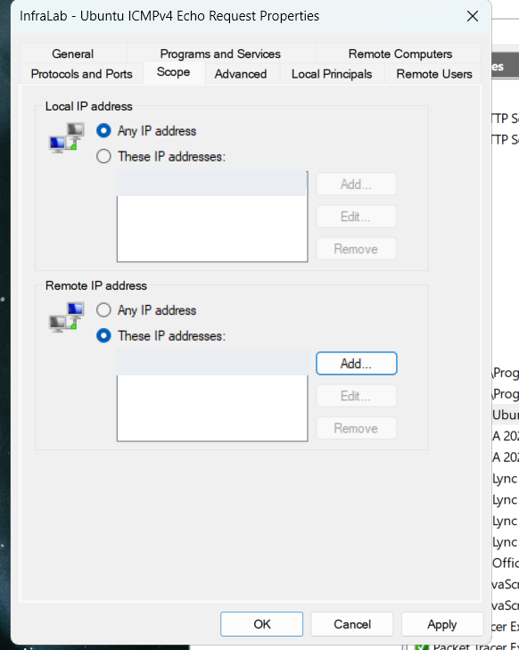
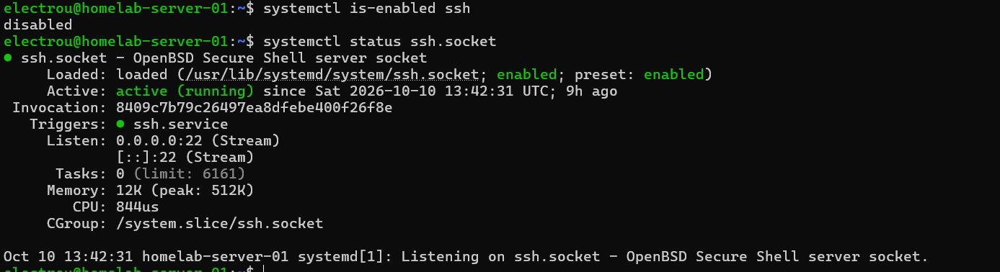
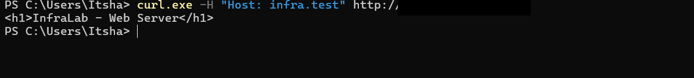
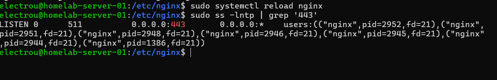
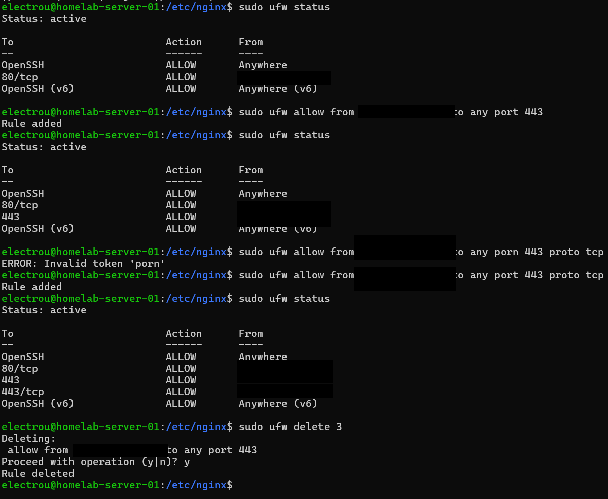
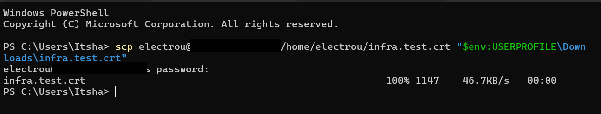
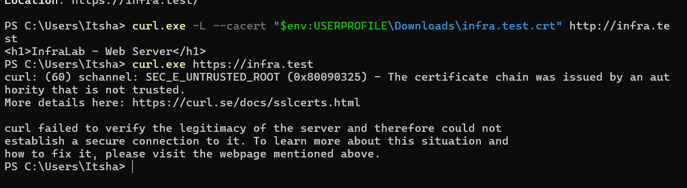

# InfraLab — Linux, Networking & HTTPS Infrastructure (Milestone 01)

> **Hands-on homelab · 9–13 October 2026 · Ubuntu Server + Windows + FRITZ!Box**  
> **Status:** working local HTTP → HTTPS path, verified using a supplied self-signed certificate.  
> **Scope:** first functioning infrastructure milestone of an evolving long-term lab. **Not a production deployment.**

This document records the actual engineering work performed on my physical home-lab machines: network discovery, a router-side DHCP reservation, firewall troubleshooting, SSH administration, Nginx virtual hosting, local hostname resolution, a TLS certificate, HTTPS and permanent HTTP-to-HTTPS redirection. It includes **selected original screenshots from the sessions**, with private IP/IPv6/MAC values masked. It is a **single technical build record**, rather than a set of exaggerated incident reports for beginner mistakes.

The general project vision and future phases remain in the repository's root `README.md` and `ROADMAP.md`. This document describes **implemented work only**.

## 1. Infrastructure and design

```text
                       Home Ethernet LAN

  Windows workstation                          FRITZ!Box router
  ┌───────────────────────┐                    ┌─────────────────────┐
  │ PowerShell / curl.exe │                    │ LAN gateway + DNS   │
  │ SSH / SCP             │───────────────┐    │ DHCP + reservation  │
  │ Local hosts entry     │               │    └─────────┬───────────┘
  └───────────────────────┘               └──────────────┤
                                                        │
                                                 Ubuntu Server
                                         ┌────────────────────────┐
                                         │ enp5s0 / DHCPv4        │
                                         │ SSH :22                │
                                         │ UFW: controlled input  │
                                         │ Nginx HTTP :80         │
                                         │   └─ 301 to HTTPS      │
                                         │ Nginx HTTPS :443       │
                                         │   └─ /var/www/infralab │
                                         └────────────────────────┘
```

| Component | Verified configuration / purpose |
| --- | --- |
| Linux host | Physical Ubuntu Server, hostname `homelab-server-01` |
| LAN interface | `enp5s0`; Ethernet, online/routable |
| Windows client | Windows PowerShell over wired Ethernet, same LAN |
| Router | FRITZ!Box 7530 AX, FRITZ!OS 8.25 during the recorded session |
| Addressing | Router-provided DHCPv4; reservation set on router, **not** a manual static address on Ubuntu |
| Router services | Local gateway and DNS indicated in Linux `networkctl` |
| Remote management | SSH on TCP 22; SCP for a public certificate transfer |
| Web service | Nginx, named site `infra.test`, content from `/var/www/infralab` |
| Firewall | UFW active, default deny incoming; HTTP/HTTPS allowances limited to the testing Windows client |
| TLS | Self-signed local certificate for `infra.test`, with SAN; not trusted by Windows by default |
| External exposure | **None demonstrated**. No Internet-facing website, router port forwarding, or production certificate is claimed. |

**Public IP convention:** exact LAN addresses are intentionally not listed. In illustrative commands, `<SERVER_IP>`, `<WINDOWS_IP>` and `<ROUTER_IP>` refer to their respective private local addresses. These are **placeholders**, not copy-ready literal commands.

## 2. Discovering the local network

I inspected the Ubuntu interface with `ip -br addr` and `networkctl status enp5s0`, and Windows Ethernet configuration with `ipconfig`. Both machines were on the same local IPv4 subnet. A second Windows adapter appeared in the diagnostics but was not the relevant physical LAN interface; the working Ethernet client was `Ethernet 3`.

The `networkctl` output confirmed the Ubuntu address was allocated through **DHCPv4 via the FRITZ!Box**. The server NIC was online/routable. The observed link negotiated **100 Mbps, full duplex**; this may deserve a later cable/port/negotiation check, but it was not diagnosed in this milestone.


**Why inspect this first?** A reachable service requires knowing the correct interface, IP assignment, subnet, gateway and which device is the client versus the server. A running application does not by itself prove network reachability.

## 3. DHCP reservation — FRITZ!Box

### Problem being prevented

The firewall tests used client- or server-specific IPv4 rules. If the Ubuntu server's DHCP address changed later, an IP-scoped rule could stop matching. I therefore configured a **DHCP reservation on the router** rather than disabling DHCP or hard-coding a static IP in Ubuntu.

### Actions performed

1. Confirmed the server was using DHCPv4, not a static manual configuration.
2. Opened the FRITZ!Box **home-network device details** for the Ubuntu server.
3. Enabled **« Attribuer l'adresse IPv4 de manière permanente »**.
4. Applied/saved the router setting.
5. Reopened the device properties and confirmed the box remained checked.


**Technical distinction:** A DHCP reservation means the router is configured to offer the same IPv4 to a particular device when it requests a lease. The Ubuntu interface still uses DHCP. This is not the same as configuring a static IP on the Ubuntu host.

**Evidence limit:** The router UI demonstrated a saved reservation. I did **not** record a deliberate lease-renewal or reboot test to prove the assigned address stays the same after restart. That remains a future verification.

## 4. Network investigation — asymmetric ICMP

### Symptom and diagnosis

- Windows → Ubuntu: `ping` succeeded (4 of 4 replies).
- Ubuntu → Windows: the initial ICMP Echo Requests received **0 of 4 replies**.
- Windows was on a **Public** firewall profile for its LAN connection.
- Windows Defender Firewall's inbound ICMPv4 rules were investigated. The restriction was inbound Echo Request handling on Windows, not proof of a defective cable or router.



### Controlled remediation

A narrowly scoped Windows Firewall inbound rule permitted **ICMPv4 Echo Request** on the appropriate Public profile from the Ubuntu server. The first rule scope mistakenly treated the Ubuntu address as a *Local IP*; on Windows, that is the target Windows address, not the source. The scope was corrected to **Local IP: Any; Remote IP: Ubuntu server**.



After the correction, Ubuntu → Windows passed **4/4 replies and 0% packet loss**.


**Lesson:** `ping` checks a particular ICMP exchange, not application ports. A firewall rule must match the protocol, direction, profile and correct local/remote scope. I keep this here as concise troubleshooting evidence; it does **not** imply a major production incident.

## 5. SSH and service management

I used Windows to administer Ubuntu through SSH, rather than relying on the server's local console. Inspection showed a working SSH service and **systemd socket activation**: `ssh.socket` was active/enabled, listening on TCP 22 and capable of triggering `ssh.service`. I learned to distinguish:

- `systemctl is-active`: is the service running now?
- `systemctl is-enabled`: is the unit configured to start/activate at boot?
- `ss -lntp`: is a TCP socket listening, and on which address/port?
- `ssh.socket` and `ssh.service`: systemd socket activation versus the daemon handling sessions.



I later used **SCP over SSH** to transfer only a **public** TLS certificate to Windows. I did not copy or expose the corresponding private key.

## 6. First web service — Nginx and UFW

### Local server versus remote access

On Ubuntu, Nginx was active, and `curl -I http://127.0.0.1` returned **HTTP 200**. The listener showed TCP 80. However, the first HTTP request from Windows **timed out**, even though ICMP connectivity had already been demonstrated.

**Root cause:** UFW was active with **default deny incoming**, and there was no rule allowing TCP 80 from the Windows client. I added a client-scoped rule instead of disabling the firewall or opening the service to the entire network. Windows HTTP access then returned **HTTP 200**, and the default Nginx welcome page opened successfully.

Illustrative firewall pattern (**replace placeholder locally**):

```bash
sudo ufw allow from <WINDOWS_IP> to any port 80 proto tcp
sudo ufw status verbose
```


**Important distinction:** A process can be `active` while not listening on the right address; a service can be listening while a firewall blocks remote clients. `systemctl`, `ss`, `ufw` and `curl` answer different diagnostic questions.

## 7. Named virtual host and local hostname resolution

The first deployment preserved Nginx's **default site** while adding another site:

| Item | Location / behavior |
| --- | --- |
| Default configuration | `/etc/nginx/sites-available/default` and corresponding enabled symlink |
| Custom configuration | `/etc/nginx/sites-available/infralab` |
| Enabled custom site | Symlink in `/etc/nginx/sites-enabled/infralab` |
| Custom web root | `/var/www/infralab` |
| Site content | `index.html`, containing `<h1>InfraLab - Web Server</h1>` |
| Hostname | `infra.test` |

Using the HTTP **Host header**, Windows reached the new virtual host on the same Nginx IP/port. A request addressed by raw server IP selected the default site instead. This demonstrated **name-based virtual hosting**, not a second physical server.

```powershell
# Example pattern, using the server IP known on your own LAN:
curl.exe -H "Host: infra.test" http://<SERVER_IP>/
```



Initially, `infra.test` was **not resolvable from Windows**. The solution was to update the **Windows hosts file** at `C:\Windows\System32\drivers\etc\hosts` (with administrator privileges), adding the local mapping in the format:

```text
<SERVER_IP>    infra.test
```

The first save attempt did not update the real protected hosts file, so `curl.exe` still reported *Could not resolve host*. After reopening/saving the correct file as administrator, `curl.exe http://infra.test` successfully returned the custom HTML page.


**Design limitation:** This was Windows **hosts-file resolution**, not a new DNS server. Other LAN devices do not automatically resolve `infra.test` until configured separately.

## 8. TLS certificate and protected files

I used **OpenSSL 3.5.5** to create a **self-signed certificate** and RSA-2048 private key for the local hostname `infra.test`, then examined the certificate with `openssl x509`.

| Item | Recorded state |
| --- | --- |
| TLS directory | `/etc/nginx/ssl` — `root:root`, intended mode `700` |
| Private key | `/etc/nginx/ssl/infra.test.key` — `root:root`, mode `600` set explicitly |
| Public certificate | `/etc/nginx/ssl/infra.test.crt` |
| Subject | `CN=infra.test` |
| Subject Alternative Name | `DNS:infra.test` |
| Validity | 13 Oct 2026 through 13 Oct 2027 (as shown by OpenSSL) |
| Trust | Self-signed and **not** trusted by Windows by default |


The setup exposed several useful Linux security lessons. I initially passed a **directory path** instead of two individual file paths; later an OpenSSL key-generation attempt prompted for a PEM passphrase. To allow unattended Nginx startup in this **lab**, the final generation used a non-passphrase-encrypted private key (`-noenc`), protected by filesystem permissions. An intermediate `chmod 600 /etc/nginx/ssl` accidentally removed the directory traversal `x` bit; it was corrected to directory mode `700`. These are normal learning errors, not separate incidents.

**Security:** Do **not** commit `infra.test.key`, SSH keys, passwords, MAC addresses, full home-network inventory, or unredacted private addressing to GitHub. A publicly readable certificate is not the secret; the private key is.

## 9. Adding HTTPS to Nginx safely

I extended the existing virtual host with a **separate TLS-enabled `server` block** on TCP 443. At this intermediate stage both HTTP and HTTPS could serve the same site. I tested Nginx's configuration *before* applying it and used **reload** rather than a full service restart.

The working design after adding the later redirect is:

```nginx
# Port 80: redirect requests to HTTPS
server {
    listen 80;
    server_name infra.test;
    return 301 https://$host$request_uri;
}

# Port 443: serve the site over TLS
server {
    listen 443 ssl;
    server_name infra.test;

    ssl_certificate /etc/nginx/ssl/infra.test.crt;
    ssl_certificate_key /etc/nginx/ssl/infra.test.key;

    root /var/www/infralab;
    index index.html;

    location / {
        try_files $uri $uri/ =404;
    }
}
```

This snippet reflects the configuration logic successfully tested during the lab; the source of truth remains the server's actual `/etc/nginx/sites-available/infralab` file and the version committed to `nginx/infralab.conf`.

### Troubleshooting during configuration

- An early `linsten` typo and a missing `ssl_certificate` produced `nginx -t` failures.
- Another version placed `ssl_certificate` inside `location {}`, and Nginx reported the directive was **not allowed there**.
- The directives were moved to the **`server {}`** context, and the final syntax test succeeded before reload.


After `sudo systemctl reload nginx`, a listener check confirmed Nginx was listening on IPv4 TCP **443** (`0.0.0.0:443` is a wildcard listener, not the server's private IP).



## 10. HTTPS firewall rule and narrow scope

UFW initially did not allow inbound HTTPS. I added an allowance for the Windows client. The first port-only rule was **broader than needed** because no protocol was specified. I then added the specific **TCP 443** rule and removed the broader rule, keeping UFW active and SSH/HTTP rules intact.

Illustrative intended HTTPS rule:

```bash
sudo ufw allow from <WINDOWS_IP> to any port 443 proto tcp
```



**Evidence limit:** The screenshot documents adding the TCP-only rule and deleting the old broader rule; it does not show a final `ufw status` **after** deletion. That final state should be rechecked as an operational follow-up. Preexisting OpenSSH rules still permitted `Anywhere`/IPv6 at the time recorded; SSH hardening was **not completed** in this milestone.

## 11. Client-side certificate verification

From Windows, `curl.exe https://infra.test` reached the TLS endpoint but returned `SEC_E_UNTRUSTED_ROOT`. That is expected: Windows did not trust the locally self-signed issuer by default.

I first used `curl.exe -k https://infra.test` as a **temporary diagnostic**. `-k` ignores certificate verification and therefore is not a security solution. The HTML page was served, confirming HTTPS connectivity.

Then I copied only the **public** `.crt` from Ubuntu to Windows over **SCP**.



Finally, Windows `curl.exe` was instructed to verify the certificate for that invocation with the public certificate file:

```powershell
curl.exe --cacert "$env:USERPROFILE\Downloads\infra.test.crt" https://infra.test
```

That produced the expected `<h1>InfraLab - Web Server</h1>` result. The same URL **without** `--cacert` still produced `SEC_E_UNTRUSTED_ROOT`. This is a correct and important distinction between **TLS being reachable**, **encryption negotiated** and **server identity trusted by the client**.


**Trust model:** `--cacert` supplied the trusted certificate for the specific curl request. We did **not** install a new trusted root authority into the Windows system trust store.

## 12. HTTP → HTTPS permanent redirect

Once HTTPS worked, I changed the HTTP port-80 virtual host to return a permanent redirect:

```nginx
return 301 https://$host$request_uri;
```

Why keep TCP 80 at all? Because Nginx now uses it to tell HTTP clients to make a new request using HTTPS. The port-443 block remains responsible for TLS and serving the HTML page. I validated syntax, reloaded Nginx and tested the headers from Windows.

```powershell
curl.exe -I http://infra.test
```

Observed `HTTP/1.1 301 Moved Permanently` and `Location: https://infra.test/`.


The end-to-end test used `-L` to follow the redirect and `--cacert` to validate TLS, **without using `-k`**:

```powershell
curl.exe -L --cacert "$env:USERPROFILE\Downloads\infra.test.crt" http://infra.test
```

The final result was the InfraLab HTML page.



**Security nuance:** a 301 redirect does not encrypt the initial HTTP request. Features such as HSTS and trusted certificate deployment are separate future security considerations; HSTS was **not** implemented here.

## 13. Evidence summary — what was actually demonstrated

| Test | Evidence / outcome | Confidence |
| --- | --- | --- |
| Ubuntu local Ethernet uses DHCPv4 | `networkctl status enp5s0` | Observed |
| Router-side DHCP reservation option saved | FRITZ!Box checkbox stayed selected | Observed; reboot/renewal not tested |
| Windows → Ubuntu ICMP | 4/4 replies | Observed |
| Ubuntu → Windows ICMP initially blocked | 0/4 replies | Observed |
| Ubuntu → Windows after rule correction | 4/4 replies | Observed |
| Remote Ubuntu administration | SSH connection / socket activation | Observed |
| Nginx local HTTP | Nginx active, localhost HTTP 200 | Observed |
| Windows HTTP access | Successful after UFW TCP 80 allowance | Observed |
| Named virtual host | Correct HTML via `Host: infra.test` | Observed |
| Windows local hostname resolution | `curl.exe http://infra.test` returns site | Observed |
| TLS identity | `CN` + `SAN` match `infra.test` | Observed |
| HTTPS listener | Nginx listening on TCP 443 | Observed |
| HTTPS content with verification bypass | `curl.exe -k` returned page | Observed diagnostic only |
| HTTPS content with explicit certificate | `curl.exe --cacert` returned page | Observed and verified |
| HTTP permanent redirect | HTTP 301 plus HTTPS `Location` | Observed |
| Complete HTTP → HTTPS → HTML | `curl.exe -L --cacert ... http://infra.test` | Observed and verified |
| Windows default trust | `curl.exe https://infra.test` still fails | Not configured yet |
| DHCP address after lease renewal/reboot | Not tested | **Open** |
| Final UFW listing after rule cleanup | Not shown in supplied final screenshot | **Recheck recommended** |
| Public Internet access, automation, app backend, monitoring | Not implemented | **Out of scope** |

## 14. Engineering decisions and lessons

**Why restrict UFW to the Windows client?** It is a controlled test environment. A service listening on a port does not justify making it available to every device. This policy still needs future review, especially for SSH.

**Why reserve DHCP at the router?** It preserves centralized DHCP management while reducing the risk of address changes breaking IP-based rules. The router remains the source of the assignment.

**Why keep two `server` blocks?** Port 80 has a single clear responsibility (redirect). Port 443 is responsible for TLS and file serving. This also made testing easier without breaking existing HTTP before HTTPS was available.

**Why use a self-signed certificate?** The hostname is strictly local and the goal was to learn TLS, certificate identity/SAN, key permissions and trust verification. It is **not equivalent to a publicly trusted production certificate**.

**What did troubleshooting teach?** Local vs remote IP is relative to the firewall host; `nginx -t` checks configuration but does not itself reload it; correct syntax can be in the wrong Nginx context; Windows `hosts` is local name resolution; `--cacert` is safer for a verification test than permanently relying on `-k`.

## 15. Known limitations and next work

- The deployed page is minimal static HTML, not a backend application or service with users.
- Local DNS is a single Windows hosts entry; no managed internal DNS service exists.
- Certificate is self-signed; Windows default trust is **not** configured, and renewal is manual.
- The DHCP reservation is saved, but resilience after DHCP renewal/reboot remains untested.
- The NIC negotiated 100 Mbps during the initial assessment; no throughput investigation was completed.
- SSH firewall policy was not fully hardened.
- No production monitoring, alerting, high availability, reverse proxy to an app, cloud deployment, container runtime, CI/CD or automation has been demonstrated yet.

**Next InfraLab iteration:** examine Nginx access/error logs, perform controlled service-failure diagnostics, add health checks/monitoring as skills develop, and later build practical automation. This will expand the **same** working infrastructure rather than starting a new isolated tutorial.

---

**Portfolio note:** The screenshots in `./evidence/` are selected original lab captures with opaque masks over private IPs, IPv6 identifiers and router MAC values; they are not generated terminal output. Paths, hostnames, dates, commands, success/failure observations and actual configurations are otherwise preserved. This document should be updated only when InfraLab reaches another meaningful technical milestone.
