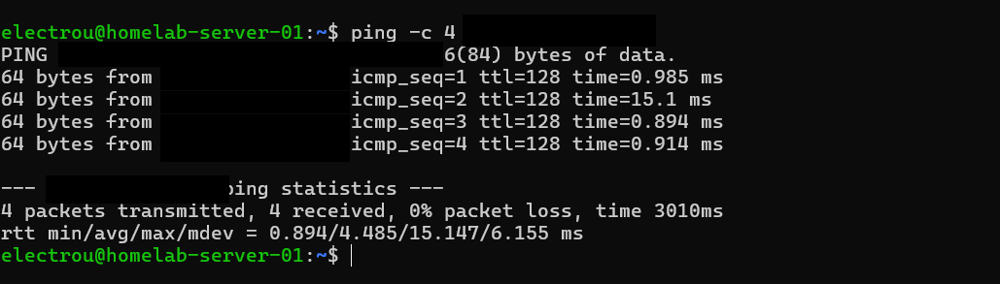
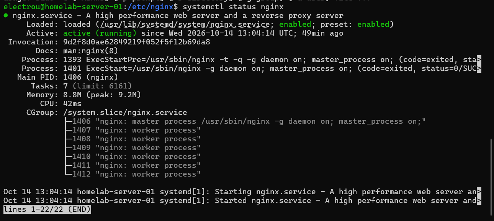
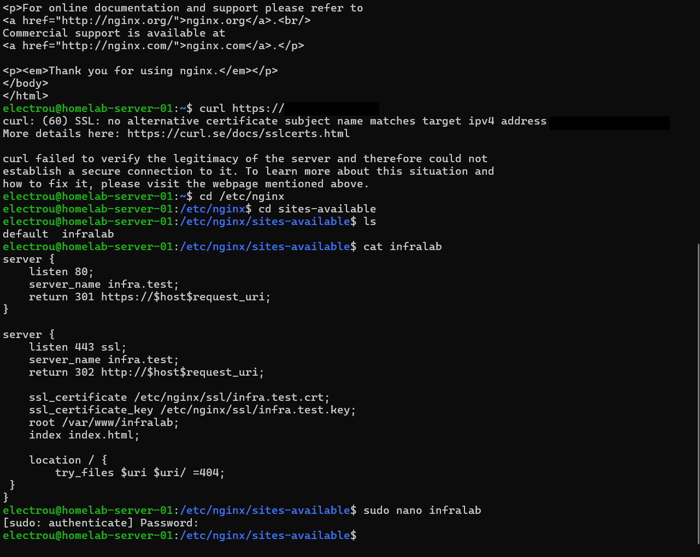
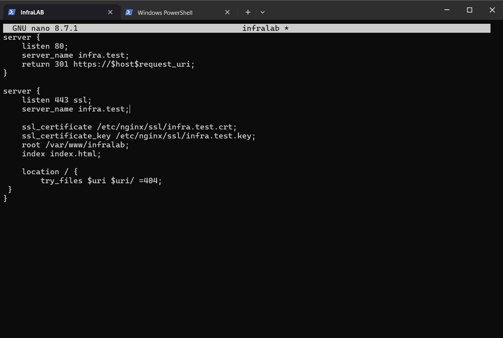

# InfraLab — What I built and what broke

*Ubuntu Server · Windows client · FRITZ!Box · October 9–15, 2026*

This is my first home infrastructure lab. I am learning Linux and networking on a **physical Ubuntu server**, using a Windows PC to administer and test it. I kept the screenshots from my own sessions because I want to show the actual work—including mistakes—not just a clean final configuration.

The project started with basic connectivity, then grew into a local Nginx website with HTTPS. After that, I tried two deliberately broken setups to practise troubleshooting. **This is a learning lab, not a production service.**

> **How I used AI:** I used ChatGPT as a learning assistant, and specifically asked it to **generate two controlled failure scripts and realistic support tickets** so I could investigate problems without being told the cause. I ran the commands and investigated on my own machines. ChatGPT also helped me understand errors, review my findings, and edit this write-up. The drill scripts in [`drills/`](../drills/) were **AI-generated**, not code I wrote myself. All screenshots are from my actual sessions; they are not AI-generated terminal output. Sensitive network identifiers were covered before publication.

## The setup

```text
  Windows laptop/PC                          FRITZ!Box router
  PowerShell, browser, curl.exe                 DHCP + reservation
      |                                           |
      +------------------- Ethernet LAN ---------+
                                                  |
                                             Ubuntu Server
                                             enp5s0 (DHCPv4)
                                             SSH (TCP 22)
                                             UFW firewall
                                             Nginx:
                                             HTTP 80  -> 301 redirect
                                             HTTPS 443 -> static website
                                             /var/www/infralab/index.html
```

- Ubuntu gets its address **through DHCP** from the FRITZ!Box; I configured the router to reserve its address.
- The hostname **`infra.test` is local**. Initially I mapped it in the **Windows `hosts` file**; it is not a public Internet domain or network-wide DNS service.
- UFW restricts incoming HTTP/HTTPS to the Windows test computer. SSH has its own rule and still needs further hardening.
- My TLS certificate is **self-signed**, valid for `infra.test`. Windows does not trust it automatically.

The real IP and MAC addresses are omitted from this public document. Any `<SERVER_IP>` or `<WINDOWS_IP>` below is a placeholder—not a command to execute unchanged.

## October 9–10 — Getting the network right

I started by checking `ip -br addr`, `networkctl status enp5s0` and `ipconfig`. I needed to understand which Ethernet interface was actually on the home LAN, where DHCP came from, and which IP belonged to the server versus the Windows client. On Ubuntu, `networkctl` reported **DHCPv4 via the FRITZ!Box**.


### DHCP reservation, not a static IP

I opened the Ubuntu device in the FRITZ!Box interface and checked **« Attribuer l'adresse IPv4 de manière permanente »**. I saved it, reopened the page, and confirmed it stayed selected.


I did this because later firewall rules refer to specific LAN addresses. A changed DHCP lease could make those rules stop matching. Importantly, I **did not configure a static IP on Ubuntu**: the router still assigns the address. I have **not yet tested renewal or a reboot** to verify reservation persistence.

### A ping worked in only one direction

Windows could ping Ubuntu, but Ubuntu initially could not ping Windows. I inspected the Windows Firewall Public profile and corrected an inbound **ICMPv4 Echo Request** rule. My first mistake was using the server IP as the Windows *local* address; I fixed it by setting the server as the *remote/source* address.

After the rule change, Ubuntu received **4/4 ping replies**. This proved ICMP worked in that direction—not that HTTP or SSH would automatically work.



## October 10–12 — SSH and my first web service

I connected to Ubuntu using SSH from Windows. The interesting discovery was that **`ssh.socket` could listen on port 22 and activate `ssh.service`**. That helped me separate a service's current state from its boot/activation configuration.

I then installed and tested Nginx. Locally, `curl` could get an HTTP response from Ubuntu, but Windows could not access the website. I checked `ss`, Nginx status, and UFW instead of assuming that a successful ping meant the website was reachable.

The cause was UFW's incoming policy: **TCP 80 was not allowed from Windows**. After adding a rule limited to the Windows client, I could load the Nginx page remotely.


### A second website on the same server

I made `/var/www/infralab/index.html` and a separate Nginx site configuration for `infra.test`, keeping the default site enabled. An important test was sending the correct HTTP `Host` header:

```powershell
curl.exe -H "Host: infra.test" http://<SERVER_IP>/
```

That returned my InfraLab HTML. An IP-only request returned the **default Nginx site** instead. I initially thought that was strange; now I understand Nginx chooses a virtual host using the request host name.

At first, `curl.exe http://infra.test` failed on Windows. My edit to the Windows `hosts` file had not saved to the real protected file. After opening Notepad as administrator and saving the actual file, the name worked.


## October 13 — HTTPS, certificates and the redirect

I generated an RSA private key and a self-signed certificate with OpenSSL, including **`DNS:infra.test` in the Subject Alternative Name**. I stored them under `/etc/nginx/ssl/`, with the directory limited to `root` (`700`) and the key file limited to `root` (`600`). The public `.crt` is not secret; the `.key` is.

I made several mistakes here: giving OpenSSL a **directory** instead of output filenames, misunderstanding options such as `-noenc`, and temporarily using file-style permissions (`600`) on the `ssl` directory, which removed its traversal `x` permission. Fixing those was part of learning Linux permissions.


Next, I put a second `server` block in Nginx for `listen 443 ssl;`. My first config tests failed because I omitted the certificate directives and later put them **inside `location {}` instead of `server {}`**. After correcting the blocks, `nginx -t` succeeded. I reloaded Nginx and confirmed it was listening on port **443**.


UFW still blocked external access to TCP 443. I allowed it from the Windows test PC, then replaced a broader port rule with a **TCP-only** rule.

### TLS worked, but Windows did not trust the certificate

`curl.exe https://infra.test` failed with `SEC_E_UNTRUSTED_ROOT`—expected for my self-signed certificate. `-k` let me confirm connectivity, but it **disables verification** and was only for diagnosis. I transferred the **public certificate** to Windows using SCP and tested it with:

```powershell
curl.exe --cacert "$env:USERPROFILE\Downloads\infra.test.crt" https://infra.test
```

The page loaded with the supplied certificate. I **did not install an authority into Windows' system trust store**, so plain `curl.exe https://infra.test` still fails with the untrusted-root error.


Finally, I configured HTTP on port 80 to return **301** pointing to HTTPS and verified the response header from Windows. I followed the redirect with `curl.exe -L --cacert ...` and got the HTML page. A redirect does **not** encrypt the initial HTTP request; HSTS was not implemented.


## October 14–15 — I asked AI to break my lab

Configuring a working site is one thing. I wanted to find out whether I could **diagnose problems without being given the fix**. I asked ChatGPT to prepare two **controlled, reversible Bash scripts** and present them as internal support tickets. I did **not** write the scripts; I used them as training tools and tried to investigate the symptoms myself.

The source scripts are included for transparency: [permissions drill](../drills/01-permissions-drill.sh) and [redirect-loop drill](../drills/02-redirect-loop-drill.sh). They are for **this isolated lab only**, require review before running with `sudo`, and have recovery mechanisms. They must not be used on production servers.

### Exercise 01 — Website content permissions

**Intended injected fault:** The first script removes all mode permissions from `/var/www/infralab/index.html` using `chmod 000`. Nginx may remain `active`, and port 443 may still be `LISTEN`, while its worker cannot read the page. That normally prevents the page from being served (typically HTTP 403 in this setup).

I spent about **40 minutes** checking ports, Nginx status, the certificate and hostname resolution, but did not isolate the underlying file-access problem. Several results were real but unrelated:

- `curl https://infra.test` **on Ubuntu** could not resolve the name because I had originally added the hosts entry on **Windows**, not Ubuntu.
- `curl http://<SERVER_IP>` showed **Welcome to nginx**, because an IP-only request selects the default virtual host.
- `curl https://<SERVER_IP>` showed a **certificate name mismatch**, because the certificate identifies `infra.test`, not that IP.
- Nginx showed **active**. That does not mean it can read every file it serves.



**What I learned:** check the webpage's response first, with the correct host name, before exploring every component. A working service process is not the same as a working website. Check content permissions and error logs when the symptoms fit.

**Honest status:** I learned the intended permission fault after the exercise. The available screenshots do **not independently prove both injection and manual recovery**, so I do not claim a successful recovery for this drill.

### Exercise 02 — Redirect loop between HTTP and HTTPS

**Ticket:** A user reports that the internal website no longer loads as expected. I investigated Nginx and the network, and opened the real site configuration.

There I found two conflicting lines:

```nginx
# HTTP server, port 80
return 301 https://$host$request_uri;

# HTTPS server, port 443 (fault injected by the AI-generated script)
return 302 http://$host$request_uri;
```

HTTP sent the client to HTTPS; HTTPS sent it back to HTTP. **That produces a redirect loop even though Nginx syntax can be perfectly valid.** The screenshot below is my **original terminal output**, with the private IPv4 values masked. It is not a recreated example.



I removed the unwanted `return 302` directive from the HTTPS block, leaving the normal `301` redirect in the HTTP block. The edited config is visible in my next original screenshot:



I reported that the site worked again afterward. **I do not have a new end-to-end recovery screenshot for this exercise**, so that last step is user-reported rather than independently evidenced here.

**What I would do better next time:** reproduce the failing request with the intended hostname and record the chain of HTTP responses *before* opening many other files. A useful future test will be checking redirect headers and `curl`'s redirect limit. DNS errors, a self-signed certificate, and a default-site response can all distract from the actual incident.

## What is working / what I still need to verify

| Area | Current evidence |
| --- | --- |
| Router DHCP reservation | Saved and seen again in FRITZ!Box; renewal/reboot test still needed |
| SSH administration | Used from Windows; socket activation inspected |
| Nginx virtual host | Served the correct HTML with `Host: infra.test` |
| UFW HTTP/HTTPS rules | Added with client-specific scope; complete final UFW audit recommended |
| HTTPS | Worked using self-signed TLS with `--cacert` |
| HTTP → HTTPS | 301 response and end-to-end redirect verified before the drills |
| Drill 01 | Cause explained; manual recovery not fully evidenced |
| Drill 02 | Redirect loop found and fixed in config; final site recovery reported |

There is no app backend, cloud deployment, automated certificate renewal, production monitoring, or public Internet exposure demonstrated by this work. The current InfraLab is **a Linux networking and web-service learning environment**.

## My next learning target

I want to make diagnosis more systematic: reproduce the actual user's symptom, check the HTTP response, inspect Nginx error/access logs, compare a known-good configuration, and only then change something. After practising that, I plan to write my **own** Bash or Python health-check script rather than just executing AI-generated fault scenarios.

---

*Screenshots are original captures from my lab sessions. Some earlier images were cropped for readability; IP, MAC, IPv6 and identifying network details were concealed. There are no AI-generated screenshots in this document. The explanatory text was edited with AI assistance; the technical work, command outputs, failures and fixes describe what actually happened on my machines.*
