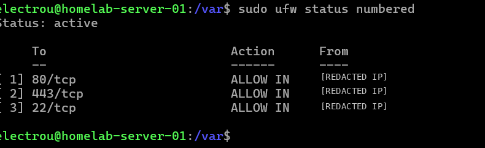
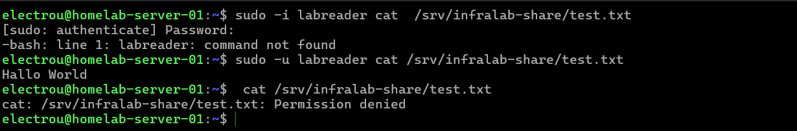
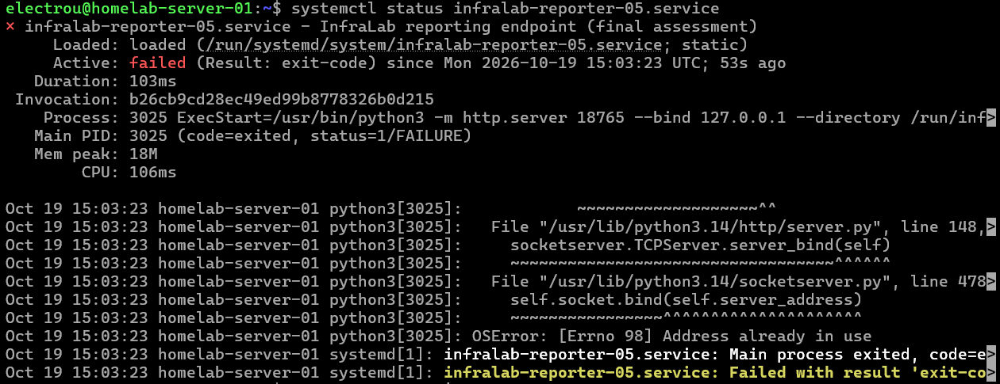
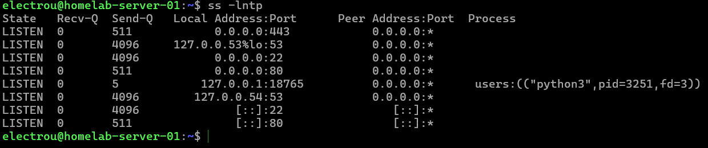

# InfraLab — Learning Log (Week 02)

**16–19 October 2026**  
**Focus:** Linux administration, access control and diagnosing service failures on my existing Ubuntu homelab.

## What I changed

- Tightened UFW: SSH, HTTP and HTTPS now have IPv4 allow rules for my Windows lab client instead of broad SSH access. I removed the general IPv4/IPv6 SSH allow rules, tested a fresh IPv4 SSH connection after narrowing the IPv4 rule, and verified HTTPS from Windows with my local certificate. I have not independently tested blocked traffic from a second client.
- Created `labreader` and a `devs` group for a root-owned test share at `/srv/infralab-share`. The directory is `750`, and `test.txt` is `640`. I confirmed that `labreader` can read the file while my normal account cannot. Read-only permissions were configured; the final write denial was not re-tested after the last changes.

## What I investigated

- Learned to inspect Nginx access/error logs and the system journal, and to use `grep`, pipes and counts to find HTTP statuses. A `404` response did not necessarily appear in `error.log`.
- Used `ps`, `top`, PID/PPID, signals, `free`, `df` and `du` on the running server. In one CPU drill I identified a `yes` process using about one CPU core; it timed out before I could practise stopping it myself.
- Investigated a controlled 1 GiB storage increase under `/var/tmp`, found the test file and removed only that file. Root filesystem usage returned to approximately 8 GiB used.
- Created a test systemd unit and investigated a simulated `200/CHDIR` failure caused by a runtime `WorkingDirectory` override pointing to a protected directory. I also accidentally removed `ExecStart` while editing the main unit. I restored it, located the drop-in through `systemctl show`/`systemctl cat`, removed the temporary override and recovered the service. The test service was later stopped and disabled.

## Final simulated incident — port conflict

An **AI-generated, isolated failure script** created a conflict between two temporary services on `127.0.0.1:18765`. These were lab exercises, not production incidents, and I did not write the injection script.

I saw `Address already in use` in the service output, used `ss` to find a listening `python3` process, checked its PID with `ps`, and found its owning systemd unit with `systemctl status <PID>`. After identifying the temporary service occupying the port, I stopped that unit and started the reporting service. I verified that it was running and listening on the expected port. I was guided during parts of the investigation; I am not claiming fully independent diagnosis.

## What I learned / next

- `active` and `enabled` are different; a `static` unit can still be started manually.
- A service can have a main unit file **and** drop-ins. `Permission denied` does not mean I should immediately weaken file permissions.
- Before stopping a process, I should identify its owner and which service manages it. After a fix, I need to verify the actual behavior, not just the command result.
- **Next:** Bash fundamentals, then my own Nginx/HTTPS health-check script. Advanced Linux and networking topics will continue through the same homelab.

**Cleanup note:** The final incident's `restore` command was supplied, but its successful execution is not yet confirmed in these screenshots. The isolated exercise should be cleaned up and checked on the server before treating it as fully closed.
