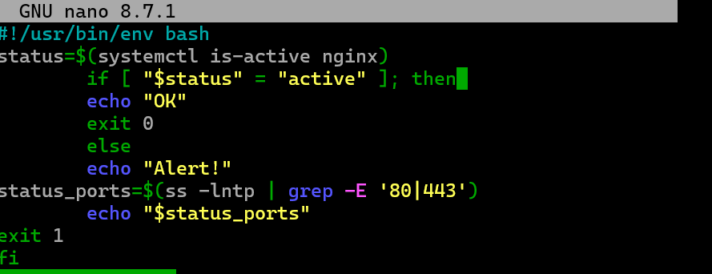
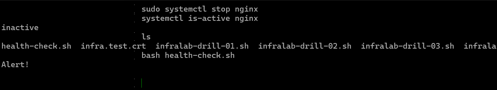
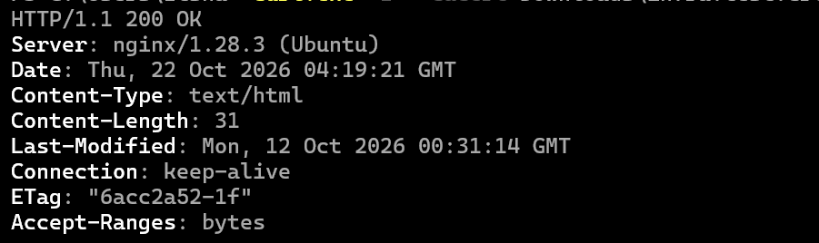
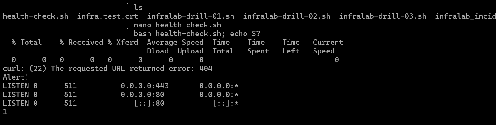
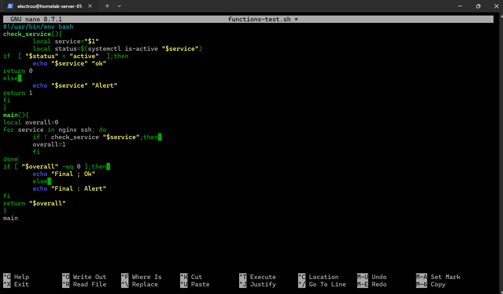
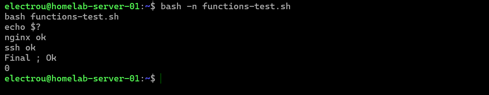
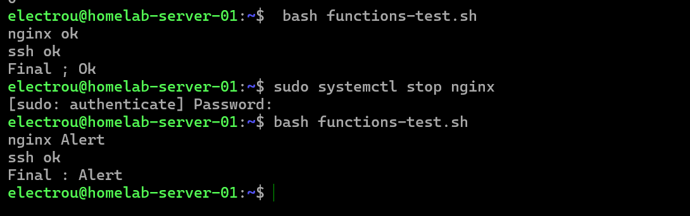
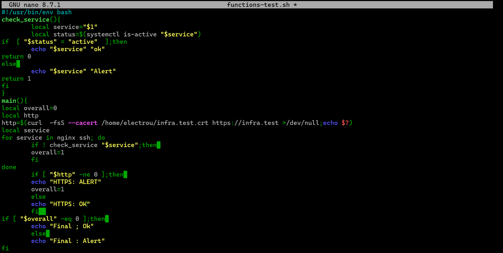
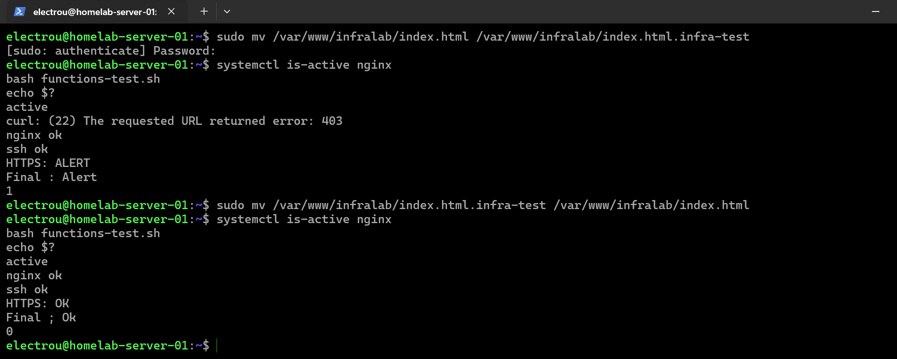

# InfraLab — Learning (Week 03)

**20–25 October 2026 · Bash fundamentals and a first health check**

This week I built my first Bash script for the existing InfraLab server. The goal was to turn manual checks into a small, read-only diagnostic — not to build a production monitoring system.

## What I built

- Created `health-check.sh` to check whether **Nginx is active** with `systemctl`.
- Added an **HTTPS request with `curl`** and a locally trusted self-signed certificate.
- Used variables, command substitution (`$(...)`), `if/else`, `&&`, and `exit 0` / `exit 1`.
- Added an initial `ss`-based view of listening ports when an alert is raised.

The script is in [`scripts/health-check.sh`](../../scripts/health-check.sh). The committed version is a **lightly cleaned-up reconstruction** of the screenshot-based script (`-fsS` to hide the progress meter and `$HOME` instead of a machine-specific certificate path). That publishing copy has **not been re-tested** in this record; the evidence below is from my own terminal tests of the learning version.

## What I tested

| Test | Observation |
| --- | --- |
| Nginx active | The first version printed `OK`. |
| Nginx intentionally stopped | `systemctl is-active nginx` returned `inactive`; the script displayed `Alert!`. Nginx was started again and confirmed `active`. |
| HTTPS reachable | `curl` returned `HTTP/1.1 200 OK` with certificate verification. |
| Nonexistent URL (`404`) | `curl -f` reported error 22 / HTTP 404; the script displayed `Alert!` and returned exit code `1`. Ports 80 and 443 were still listening. |
| Original URL restored | The script returned to displaying `OK`. |

The HTTP 404 was a **deliberate test using a nonexistent path**, not an unexpected production incident.

## Evidence

**First Bash version:** service state, an `if/else` decision, basic port check and exit codes.

**Service stopped:** the script detects the inactive Nginx service.

**HTTPS response:** the site returns HTTP 200 when requested with certificate verification.

**HTTP 404 test:** the script flags a failure even while ports 80/443 are listening, and returns `1`.

**Recovery:** after restoring the normal URL, the script displays `OK` again.

## Lessons and limits

- An **active service** does not guarantee that the **web application responds as expected**.
- A `curl` **exit code** (such as `0` or `22`) is different from an **HTTP status** (such as `200` or `404`).
- `curl -f` catches typical HTTP 4xx/5xx failures, but **does not enforce exactly HTTP 200**. A redirect can still count as success.
- The current port filter (`grep -E '80|443'`) is **not precise**: it could also match other port numbers. This will be improved later.
- This is a **local check on the server**, not proof that clients on the network can reach it. I also tested HTTPS from Windows separately.
- The script reports an issue; it **does not automatically restart services or change firewall rules**.

## Follow-up — 23–24 October 2026

I refactored the health-check exercise into a second **local learning script**, `functions-test.sh`. This is separate from the earlier committed `scripts/health-check.sh`; the improved script has **not yet been confirmed as published or tested in its eventual GitHub form**.

### What changed

- Created a reusable `check_service()` function that accepts a service name through `$1`.
- Used `local`, `return 0` / `return 1` and a `for` loop to check Nginx and SSH without repeating the same block.
- Added `main()` with an `overall` result. A later successful check does not hide an earlier failure.
- Added an HTTPS check using `curl -fsS --cacert`, with TLS verification enabled, and an explicit `HTTPS: OK` / `HTTPS: ALERT` message.

### Real tests on the Ubuntu server

| Scenario | Observation |
| --- | --- |
| Nginx and SSH active | Both reported `ok`; the script reported final `OK` and exited `0`. |
| Nginx deliberately stopped | `nginx Alert`, `ssh ok`, and final `Alert` appeared. Nginx was subsequently restored. |
| Website entry point temporarily moved | Nginx remained **active**, but the HTTPS request returned **HTTP 403**, and `curl` reported exit code **22**. The script reported `HTTPS: ALERT` / final `Alert` and exited **1**. |
| Website file restored | Without restarting Nginx, the checks returned to `HTTPS: OK`, final `OK`, and exit code **0**. |

The HTTP 403 was caused by **temporarily moving the lab's `index.html` file** and restoring it afterward. This was a controlled, reversible test on my homelab, not a production outage.

### Additional evidence

**Reusable function and loop:** a single function receives each service name and the main function keeps a shared failure result.

**Normal execution:** both services were active and the final exit code was `0`.

**Controlled service interruption:** Nginx was stopped and reported `Alert` while SSH was still OK.

**HTTPS check added:** the learning script combines service-state checks with an HTTPS request.

**Application-level failure and recovery:** the same terminal capture shows Nginx `active`, HTTP 403 and exit `1`, followed by restored `index.html`, HTTPS `OK` and exit `0`.

### Takeaways and remaining limitations

- `systemctl is-active` only reports service state; it does not prove the website is usable.
- `curl` failure detection improves the check, but `-f` does **not** require an exact HTTP 200 response.
- Checks were made **from the Ubuntu server**; they do not establish external client availability.
- The learning script still has no explicit request timeout, scheduling, alert delivery or automatic recovery. It is **not production monitoring**.
